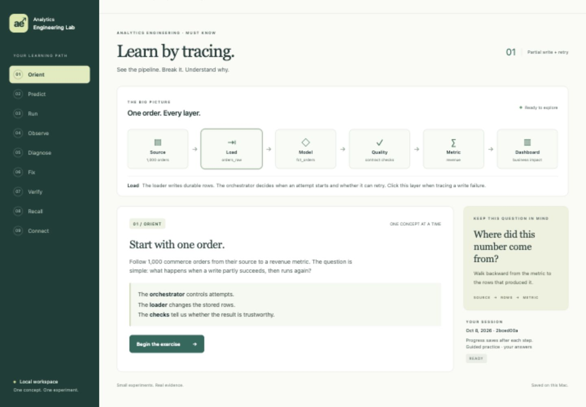

# Browser UI verification — 2026-10-08

Implementation checks and browser smoke checks performed in this task:

- `uv run pytest -q`: **72 passed in 66.09 seconds**. Includes the complete native HTTP learning journey, incorrect-answer gates, evidence disclosure, retained sessions, request guards, and resume states.
- `node --check lab/web_assets/app.js`: passed.
- `zsh -n Start-AE-Lab.command`: passed; launcher executable and Desktop symlink confirmed.
- Desktop shortcut invoked against the running default Lab server: exited successfully and opened its localhost URL.
- Systems registry validator: passed for 10 systems.
- Browser forms exercised prediction, real failure execution, diagnosis, upsert repair, verification, recall, and completion. All eight recovery criteria passed. Reload resumed the saved exercise. Recall inputs were blank after repair, preventing accidental answer carryover.
- Browser QA session was explicitly marked as an automated demonstration; completion retained VERIFIED status without awarding learner mastery. A fresh unassisted exercise was then created and left at Orient.
- Desktop layout checked at 1440 × 1000; narrow layout checked at 375 × 900. The narrow document width remained 375 pixels with no page-level horizontal overflow. Pipeline scrolling stays within its card. Temporary viewport overrides were reset.

These are implementation and smoke-check results, not an independent verification sign-off. The existing Phase 1 verification document remains separate. Native adapter evidence and project limits remain authoritative: this exercise does not measure freshness or provide a live BI dashboard.

