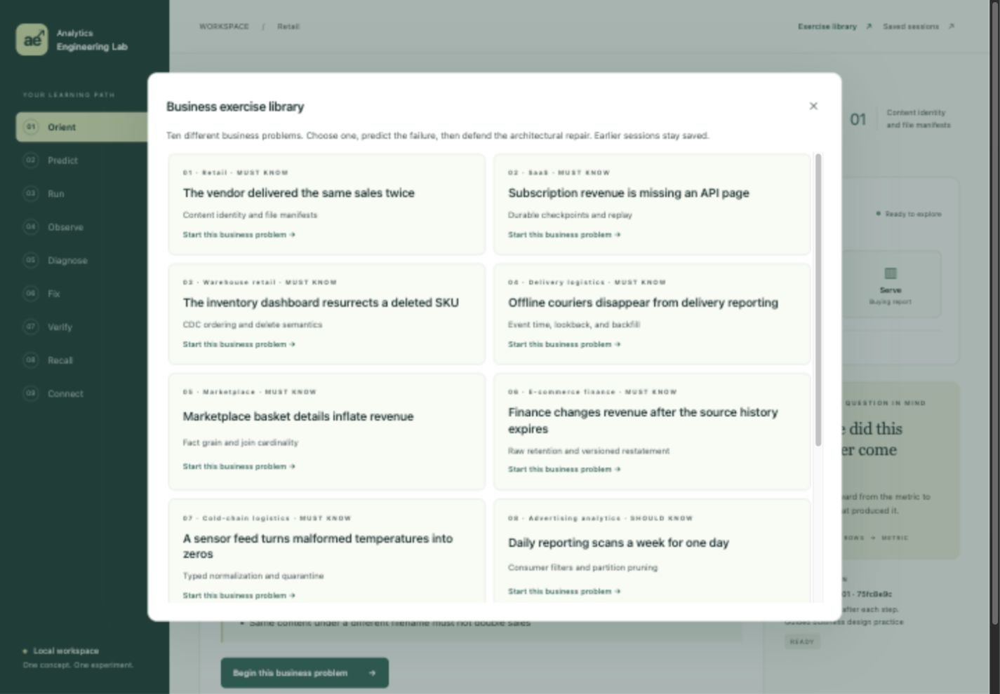
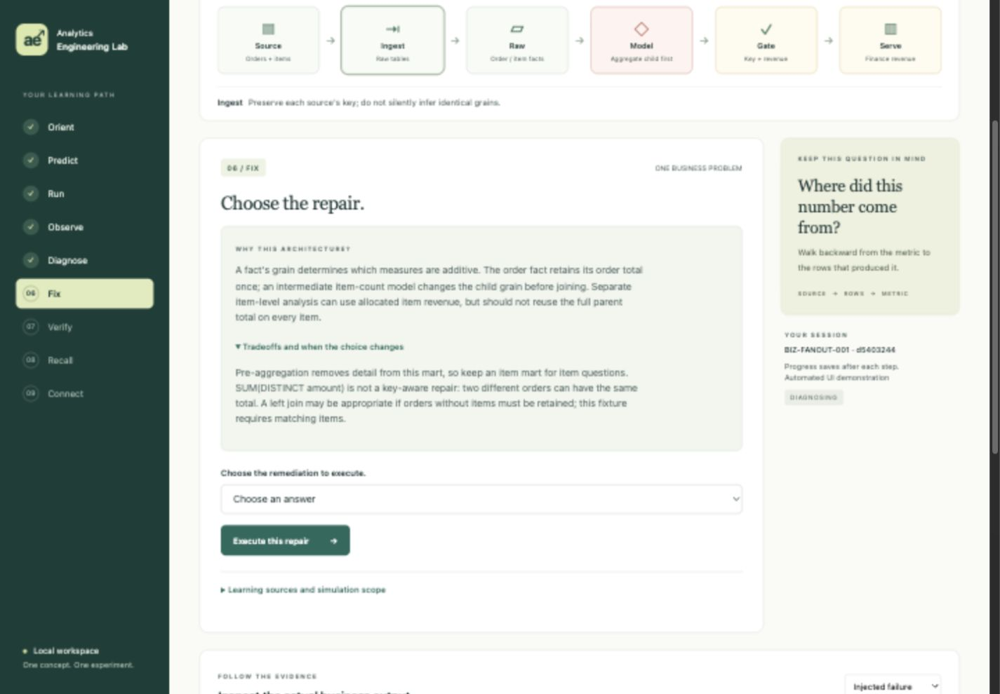

# Business exercise implementation checks — 2026-10-11

These are implementation and browser smoke checks, not an independent
verification sign-off. The earlier Phase 1 verification remains separate.

## Commands and results

- Full `uv run pytest -q`: **83 passed in 98.98 seconds** (72 existing checks plus 11 new checks).
- After final output-grain metadata and diagram-color refinements, targeted `uv run pytest -q tests/e2e/test_business_web.py`: **11 passed in 32.77 seconds**.
- `node --check lab/web_assets/app.js` and `node --check lab/web_assets/business-app.js`: passed.
- `zsh -n Start-AE-Lab.command`: passed.
- Desktop symlink launcher invoked against the current localhost server: exit 0; opened the Lab URL.
- Systems registry validator: passed for 10 systems.
- `git diff --check`: passed.

## Exercised criteria

All ten complete HTTP journeys invoke real native Modeling, Quality, and
Toptal runtimes. Tests assert independently authored faulty/repaired counts
and values, incomplete/duplicate gates, wrong diagnosis and repair rejection,
wrong recall retention, stable replay, retained fault snapshots, source pinning,
scenario-correlated events, Mermaid outputs, exact reload state, and separate
new attempts. A faulty candidate cannot move the local release pointer away
from the validated baseline. CLI inspect works on business evidence; executable
original-scenario CLI commands reject a business session with an actionable
browser continuation message.

Observed fault → repaired outcomes:

| Case | Fault | Repaired |
|---|---|---|
| Vendor files | 4 sales / USD 150 | 2 sales / USD 75 |
| API pages | 2 invoices / USD 220 | 4 invoices / USD 440 |
| CDC deletes | 2 SKUs / 17 units | 1 SKU / 5 units |
| Late couriers | 2 events / 10 minutes | 4 events / 24 minutes |
| Join fanout | 3 rows / USD 250 | 2 rows / USD 150 |
| Finance restatement | 2 rows / USD 150 gross | 2 rows / USD 120 net |
| Sensor schema | 3 misleading readings | 2 normalized readings / 1 quarantined input |
| Partition scope | 700 assumed MB | 100 assumed MB |
| ML as-of snapshot | Feature checksum 150 | Feature checksum 40 |
| Snapshot publication | 1 candidate row / USD 100 | 3 committed rows / USD 300 |

Finance restatement, scan scope, and ML temporal leakage have native quality
PASS but business reconciliation FAIL before repair; publication stays blocked.
This demonstrates the scoped nature of generic schema/key/volume checks.

## Browser smoke check

The exercise library visibly lists all ten new problems and the original retry
exercise. The marketplace case was completed through actual forms: prediction,
failure, diagnosis, explanation/tradeoffs, repair, verification, recall, and
completion. Diagram clicks preserved a selected prediction. Recall started
blank. A server restart and page reload resumed the saved Observe step. The
browser QA session was marked as an automated demonstration, separate from
learner evidence. A fresh vendor exercise was then created and left at Orient,
with the library open for the user.

Desktop checked at a 1440 × 1000 viewport; mobile checked at 375 × 900. The
mobile document width and scroll width both measured 360 pixels (the viewport's
scrollbar occupies the remaining width); the dialog fit at 324 pixels. The
pipeline and step strip scroll within their containers. Temporary viewport
overrides were reset before delivery.

These fixtures simulate source/API/CDC/commit conditions. Tests do not establish
live connector recovery, freshness SLAs, cloud costs, performance, production
orchestration, ML accuracy, or independent learner mastery.

