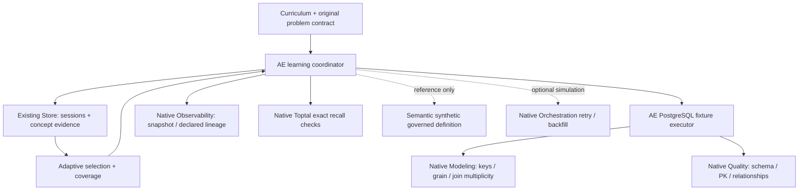

# Reusable learning framework — Step 1

This is the Step 1 delivery record. The [Step 2 SQL extension](sql-problem-engine.md)
now supplies the comprehensive problem bank through this same framework.

This extends the registered `projects/AE Lab/` project on
`codex/ae-lab-grain-interviews`. The later request limits this delivery to the
framework and exactly seven representative exercises. A full problem bank is
explicitly deferred.

## Existing architecture and gaps

Inspection covered root guidance, `SYSTEMS.md`, the owning registry entry, the
Lab's architecture, scenario formats, Store, CLI/browser, evaluation/disclosure,
fixtures, adapters and tests. The original Lab has `lab` / `lab-web`, a nine-step
retry lesson (`lab/learning.py`), ten business exercises (`lab/business_catalog.py`),
`Lab` / `BusinessLab` coordinators and versioned documents in `.lab/state.sqlite`.
SQLite warehouses and evidence files are isolated by run. Business SQL runs through
native Modeling's DuckDB connection. Native subprocess adapters call Modeling,
Quality, Observability, Orchestration and Toptal. The baseline suite passed **83 tests**.

There was no shared curriculum taxonomy, general problem contract, cross-task
concept ledger, spaced recall or adaptive selector. Those are the added pieces.
No existing engine, scenario format, learner record or sibling source was replaced.
Toptal examination and canonical mastery remain separate.

## Architecture and ownership



`ae-learning-v1` records share the existing Store but keep their own format.
`/learn` and `lab-learn` share the existing server and state profile. Original
`/` and `lab` routes still work. Cross-surface dispatch is rejected.
`lab/problems.py` is the single learning catalog;
`lab/sql_lab/catalog.py` holds only its three private SQL execution contracts,
also reused by the debugging example. It is not another curriculum bank.

The Lab owns deterministic fixtures and SQL execution in disposable PostgreSQL
schemas. Expected rows come from independent authored Python calculations, with
hand-calculated financial sentinel tests. Native Modeling checks actual result
keys, grain and source join multiplicities; Native Quality executes schema/PK/FK
rules. Observability imports explicitly adapter-produced dbt-shaped evidence;
no dbt execution or observed column lineage is claimed. AST warnings are labeled
potential risks; output mismatches and native multiplicities are actual evidence.

Optional Orchestration calls simulate dependencies, transient retry and historical
partition replacement. They do not run PostgreSQL jobs. Semantic reads the existing
synthetic governed contract and explicitly reports incompatibility: its bounded
contract requires fulfilled-order time and one product identity per order. It
cannot certify the lending or mixed-product exercise metrics. FDE discovery is
curriculum coverage; no duplicate FDE execution engine was built.

## Curriculum, difficulty and coverage

`curriculum/curriculum.json` covers 18 areas: SQL, Python, Spark, Modeling, dbt,
Pipeline, Storage, Orchestration, Quality, Observability, Semantic/Metrics,
Reliability, Performance/Cost, Business, System Design, Debugging, Incident Response
and FDE Discovery. The current map has 446 stable group/sub-concept IDs, including
`sql.joins.fanout` and `modeling.dimensions.effective_intervals`.

L1–L6 difficulty has separate dimensions for code complexity, ambiguity, data
cleanliness, hidden cases, systems, scale, business semantics, reliability,
incomplete evidence, operational risk and conflicting stakeholders. Code length
is not a difficulty score.

`curriculum/coverage-matrix.json` is an **authored availability baseline** with
no learner observations; regenerate with `scripts/curriculum_inventory.py`.
Live coverage derives from the selected profile's append-only evidence, via the
API or `lab-learn coverage`. It records concept/domain/difficulty, available and
attempted problems, successful/failed attempts, last tested, mastery state and
transfer evidence. No invented percentage or automatic parent mastery rollup.
Most concepts deliberately have no representative example yet; these are real gaps.

## Problem contract and disclosure

`contracts/problem.schema.json` validates identity, context, difficulty, skills,
table contracts/sample rows, requirements/output grain, private edge cases/tests,
learner prompts/answers, evaluation rules, follow-ups/mastery tags, four hints,
solution, transfer link, modes, artifacts and 1–3 concept-mapped recall questions.
Authored `learner_answer` is null; real answers live in saved attempt records.

Learner views use a positive allowlist. Initial responses contain no solution,
hidden tests, rule answers, unused hints, transfer tags or recall answers. Advanced
modes omit skill tags and instructional pattern metadata; the necessary physical
schema/keys remain visible. Clean source examples appear first. An incorrect
submission reveals its actual failing fixture rows and a relevant actual/expected
comparison. Interview comparisons wait until the question is finished.

Hints progress layer → concept → narrower cause → principle. LEARN has four,
PRACTICE/INCIDENT two, INTERVIEW none. A solution requires an attempt and then
three failures or an explicit request; an interview question must also be finished.
Hint/solution exposure marks subsequent application evidence assisted.
This is pedagogical disclosure for a personal local tool, not protection against
reading answer keys in source or the explicit tutor-only evidence CLI.

## Learning loop and modes

```text
SEE / PREDICT → REQUIREMENTS + GRAIN / PROPOSE → RUN / OBSERVE
  → DIAGNOSE / FIX → VERIFY → LATER RECALL / TRANSFER → CONNECT
```

A submission needs a saved observation, requirements, row meanings and approach;
SQL additionally needs input/output keys. Students can revise these after a failure.
The browser presents one actionable phase, small tables and a simple Source →
Model → Quality → Consumer diagram. Wrong answers preserve SQL and show the
actual execution error or result beside expected output. Feedback prioritizes one
issue in ERROR / FIX / WHY / TRY AGAIN form. Raw delivery versus eligible logical
contribution tracing and native join multiplicities make grain errors visible.
Draft SQL survives hints and is prefilled after a failed attempt.

Modes are LEARN, PRACTICE, INTERVIEW, DEBUG, SYSTEM_DESIGN and INCIDENT. DEBUG starts
with broken SQL and actual execution output. SYSTEM_DESIGN saves requirements and
judgment for review. INCIDENT starts with symptoms/evidence and withholds the broken
query/root cause. Architecture answers are `REVIEW_REQUIRED`; no keyword grader
certifies them. Model exercises use native grain/key declarations and explicit
interval/additivity choices. Causal prose remains pending tutor review.

The tutor CLI requires an actual saved attempt, reviewer identity, rationale,
boolean criteria and the exact concepts assessed. Architecture review must cover
all authored criteria. No learner-facing web route approves reviews. This is a
trusted personal CLI, not a multi-user authentication system.

## Mastery and selection

```text
UNSEEN → INTRODUCED → UNDERSTOOD → APPLIED → DEBUGGED → TRANSFERRED → MASTERED
```

`learning_evidence` is append-only and rejects altering an existing evidence ID.
Events record concept, task, business domain, difficulty, timestamp, outcome,
assistance and evidence reference. Understanding/debugging additionally requires
a reviewer and causal rationale tied to the saved attempt.

- INTRODUCED: saw a problem.
- UNDERSTOOD: independently reviewed causal explanation for this concept.
- APPLIED: correct unassisted executable or reviewed solution.
- DEBUGGED: correct unassisted repair with reviewed diagnosis on a different task.
- TRANSFERRED: unassisted success on another task/business domain at least a day later.
- MASTERED: all preceding evidence, at least three distinct tasks/two domains,
  two successful unassisted recall days and a seven-day evidence span.

Correct queries cannot skip missing understanding/debugging evidence. Repeated,
assisted and same-day different-domain answers do not establish transfer. Failures
remain weakness evidence. Recall intervals are 1, 3, 7, 14 and 30 days; a failed
recall is due after one day. Native exact short checks record only the concepts
mapped to each prompt; alternate valid prose needs tutor assessment.

Selection prioritizes due short recall, weak concepts in a different business
context (simpler after repeated failures), missing transfer, then less-tested/unseen
appropriate-level coverage. No suitable different context produces a coverage gap,
not a renamed duplicate or invented task. With only seven examples, some concepts
cannot yet gather the full range of mastery evidence.

## Representative exercises

| Problem | Type | Context |
|---|---|---|
| SQL-LOAN-001 | SQL, L3 | Harbor Lending principal, event versions, missing loans and currency |
| SQL-ORDER-001 | SQL, L3 | Moss Market order lines and refund grains |
| SQL-INVOICE-001 | SQL, L2 | Orbit Desk final paid-invoice state; transfer from lending |
| MODEL-GRAIN-001 | Modeling, L2 | Received-event versus logical-transaction identity |
| MODEL-SCD-001 | Modeling, L3 | Contract versions, effective boundaries and snapshot additivity |
| DEBUG-ORDER-001 | Debug, L4 | Changed finance total, broken query, actual row evidence |
| ARCH-PIPELINE-001 | Architecture, L4 | Daily source versus 15-minute SLA, consumers and replay |

Companies, data, numbers and scenarios are original. The public
[DataDriven pipeline lesson](https://datadriven.io/learn/pa_pattern_design_pipeline_intermediate)
was a concepts reference only; no verbatim or inaccessible problems were used.
PostgreSQL boundaries follow its
[transaction docs](https://www.postgresql.org/docs/17/sql-set-transaction.html) and
[statement settings](https://www.postgresql.org/docs/17/runtime-config-client.html).

## Commands

From the existing AE Lab directory:

```sh
uv sync --extra dev
brew install postgresql@17  # only if binaries are missing
uv run python scripts/postgres_local.py start
uv run lab-web --open
# Visit http://127.0.0.1:8088/learn or click Curriculum practice.
uv run lab-learn catalog
uv run lab-learn start MODEL-GRAIN-001
uv run lab-learn recommend
uv run lab-learn coverage --output .lab/coverage-matrix.json
uv run pytest -q
```

`AE_LAB_PG_BIN` can select installed PostgreSQL binaries. The helper uses only
project-local `.lab/postgres` and a private Unix socket, with no TCP listener or
login service. Stop with `scripts/postgres_local.py stop`. For another local
profile, pass `--state-dir`. An alternative `AE_LAB_POSTGRES_DSN` must identify a
**dedicated** database whose name starts `ae_lab`; call `Postgres().bootstrap()`
before execution. Never use a production/shared database.

SQL allows one bounded read-only SELECT over displayed sources and safe analytical
functions, as a non-superuser reader in a read-only transaction with a two-second
timeout and row/temp limits. This is a fixture executor, not a hostile multi-tenant
sandbox. No arbitrary Python/Spark execution was implemented.

`lab-learn act RUN_ID predict|prepare|submit|hint|revise|finish|reveal --answer-file
answer.json` operates on saved sessions. `view` is learner-safe; `evidence` explicitly
shows full tutor/developer evidence and attempt IDs. `review RUN_ID ATTEMPT_ID
--review-file review.json` takes reviewer/rationale/criterion booleans/concepts.
`recall PROBLEM_ID --concept CONCEPT_ID` starts a due short check. `integrations`
checks the PostgreSQL, synthetic Semantic reference and native virtual replay paths.

## Deferred

Comprehensive problem banks, Python/Spark execution, additional business verticals,
production dbt/cloud jobs, multi-user auth, hostile-code sandboxing, timeboxed
multi-question interviews, automatic prose grading and canonical examination
mastery remain future work. INCIDENT currently reuses representative contexts
with symptom-first disclosure; broader incident content is deferred.

If the local Lab server was already running before the code changed, restart
that server to load the new routes. Saved session/evidence data remains in the
same profile; the framework does not reset it.

The final hidden fixtures include downward amount revisions, a late older event
with a higher event ID, and a restored paid invoice state at tied timestamps.
Amount/status, arrival-time or event-ID-only ordering cannot imitate business
event ordering accidentally. Private fixture and oracle hashes are part of each problem's
definition digest; a changed hidden test requires a fresh session instead of silently
reusing an earlier acceptance receipt. Nullable source money emits the native
Quality engine's nonblocking `WARN` evidence, even where this exercise explicitly
defines its contribution as zero; the warning is visible after submission.
