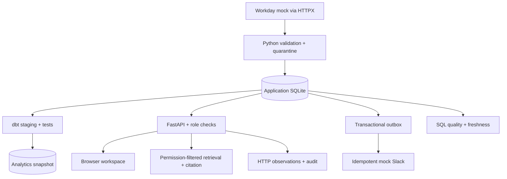

# Architecture and contracts

## Business boundary

The application serves a fictional 5,000-person company's HR support needs.
The initial dataset is deliberately small; the growth scenario exercises about
5,000 records without introducing a distributed platform.

| Stage | Information in | Change | Information out |
| --- | --- | --- | --- |
| Mock Workday | Packaged fictional JSON | Shift fixture dates, paginate, inject selected failure | HTTPX responses |
| Validation | Source dictionaries | Normalize strings/dates; reject invalid fields | Canonical rows and reason codes |
| Ingestion | Canonical candidates | Keep newest duplicate, check managers/emails, version-gated UPSERT | Employees, raw lineage, quarantine, run evidence |
| dbt | Selected application columns | Build staging tables and marts; test outputs | Separate analytics.db snapshot |
| FastAPI | Authenticated JSON requests | Validate input; enforce role and ownership | Metrics, tickets, tasks, policies |
| Policy retrieval | Question and authorized policies | Chunk, rank with sparse TF-IDF, require similarity threshold | Exact passage and versioned citation, or escalation |
| Workflow | A new employee or overdue request | Insert a stable-key event in the transaction | Outbox rows |
| Mock Slack | Pending/failed outbox events | Retry, deduplicate at the local receiver | Identifier-only messages and delivery status |
| Operations | Runs, HTTP timings, data, audit actions | Check freshness and invariants; summarize signals | Health dashboard and failure evidence |



## Database relationships

An employee ID is the primary key: one identifier names one employee record.
A request's employee ID is a foreign key, so a request cannot point to a
nonexistent employee.

| Relationship | Cardinality | Example |
| --- | --- | --- |
| Employee → requests | One to many | Maya owns HR-001 and may submit another request |
| Employee → onboarding tasks | One to many, unique employee/kind | One orientation task per hire |
| Employee → manager | Many to one, nullable root | Jordan reports to Maya |
| Ingestion run → raw/quarantine | One to many | Every rejected row names its source run and row number |
| Outbox event → mock message | One to zero/one, unique event key | A failed event has no delivered message yet |

`connect()` enables SQLite foreign keys on every connection. Transactions
commit employee changes and onboarding/outbox creation together; an internal
failure rolls back that business transaction while a separate run record
preserves the failure outcome.

## Ingestion contract

Required source fields are `employee_id`, `full_name`, `email`, `department`,
`status`, `hire_date`, `salary_cents`, and a timezone-aware
`source_updated_at`. `manager_id` and `termination_date` may be null.
Accepted statuses are active, leave, terminated, and prehire. Terminated rows
require a valid departure date no earlier than hire and no later than the
lesson date; active/leave records cannot start in the future.

Newest source timestamp wins duplicate selection, with the later source row
breaking equal-version ties within one batch. Existing employee versions are
updated only when the incoming timestamp is strictly newer. Replays and old
versions are counted as unchanged; absence from a later delivery does not
delete or terminate an employee. This demo relies on explicit termination
events and does not implement a full source snapshot reconciliation policy.

Successful runs satisfy:

```text
received = accepted unique candidate identities + rejected rows + duplicate rows
accepted = changed + unchanged
```

Duplicate losers are recorded in quarantine with `duplicate_superseded`, but
are counted separately from invalid rows. Raw payloads remain in the local
database; the browser shows reason counts rather than raw salaries. A
permanent fetch or response-contract failure commits no employee changes.
Source pages each allow three attempts with bounded exponential delay.

The growth scenario returns 5,001 source rows and 4,995 accepted identities
at its default setting: the deliberate invalid/duplicate cases remain present,
and EMP-021 is reserved for the separate new-hire scenario. The `volume`
argument bounds the synthetic identifier range, not an exact accepted count.

## Metric definitions

| Metric | Definition |
| --- | --- |
| Current headcount | Active/leave records with hire date on or before as_of |
| New hires, 30d | Hire dates from as_of minus 29 days through as_of, excluding prehires; includes hires who subsequently departed |
| Departures, 30d | Termination dates in that same inclusive 30-day window |
| Unresolved requests | Open plus in_progress |
| Onboarding completion | Completed tasks / all assigned tasks, including upcoming hires |

These are current-state operational metrics. Historical snapshots, rehires,
employment episodes, contingent workers, multiple jobs, and policy variations
by country would require richer contracts. The monthly dbt model reconstructs
hire/departure events from current records and omits months with no events.

## API and permission contract

All `/api/` business endpoints require a generated Bearer token, except the
deliberately public `/api/demo/identities` in demo mode. Tokens are stored as
SHA-256 digests in the database; the local credential file contains the
original random tokens and is created with owner-only permissions.

| Capability | Employee | Analyst | HR |
| --- | --- | --- | --- |
| Read employee details | Own | Denied | All |
| List employee directory | Denied | Denied | Allowed; salary excluded |
| Metrics | Denied | Aggregate | Aggregate |
| Requests | Own; create | Denied | Read, create on behalf, change status |
| Onboarding | Own tasks | Denied | All tasks |
| Policies and assistant | Available company policies | Available company policies | Company and HR policies |
| Pipeline, notifications, audits | Denied | Denied | Allowed |

`GET` retrieves, `POST` submits, and `PATCH` changes a defined part of an
existing resource. Invalid bodies return 422; missing/invalid credentials
return 401; prohibited actions return 403; unavailable or restricted policy
IDs return the same 404; a conflicting idempotency key returns 409.

Creating a request requires an `Idempotency-Key` header. The employee/key pair
is unique, and a hash of the input detects key reuse with different content.
The first submission returns 201; an identical replay returns 200 with the
same request ID. Request ownership comes from the token; changing a browser
selector, URL, or `X-Role` header cannot override server checks.

Loopback binding, trusted-host checks, no cross-origin API allowance, no-store
responses, content security policy, escaped browser rendering, and parameterized
SQL constrain the local interface. Demo identities remain intentionally
switchable; these measures do not turn the demo into production authentication.

## Retrieval and routing

Retrieval filters inaccessible/unavailable documents before chunking or
ranking. Sparse TF-IDF vectors represent word frequency and rarity; cosine
similarity ranks passages after a small synonym expansion. Below a 0.16
similarity threshold, or on selected sensitive/injection patterns, the
assistant escalates. A supported answer is an exact approved passage with
policy ID, title, and version. Similarity is not calibrated confidence, and
the ten evaluation cases are a regression fixture rather than a benchmark.

RAG normally retrieves context and then asks an LLM to generate an answer.
This first implementation uses extractive answer assembly to make support
and citations directly testable. A future neural embedding index could improve
paraphrase matching, and an LLM could summarize authorized passages; both
would need a broader labeled evaluation set, refusal tests, citation checking,
latency/cost measurements, and explicit decisions about data leaving the host.
The keyword safety patterns are conservative examples, not a comprehensive
prompt-injection defense. Exact extraction still needs relevance evaluation.

Ticket routing uses transparent keyword rules. Ambiguous/unknown requests go
to HR Triage, and sensitive employee-relations terms take precedence and route
to People Partner. The routing confidence is a rule indicator, not a learned
probability. HR access is broad in this learning model; assigned-case
permissions would be needed for a real confidential relations workflow.

## Operations and recovery guarantees

`/health` checks process/storage liveness. `/ready` returns 503 if source data
is stale/missing or the latest pipeline run failed. Source age over 48 hours
or successful-sync age over 24 hours marks data stale. This does not stop
employees from reading the last successful dataset. The UI presents the
freshness state and observed HTTP performance separately.

HTTP observations keep at most 1,000 route-template timings and response codes.
Availability is the share of observed responses below 500, including deliberate
simulation failures in the denominator; it is not a production SLO. Audit
events record actor/action/target/outcome with bounded operational metadata;
they omit question text, ticket descriptions, salaries, and tokens. Local
audit logs are not tamper-proof or a compliance archive.

Notification draining retries each pending/failed event up to three times per
invocation. A later drain retries failed events again. The mock receiver
deduplicates by event key, and receipt/status commit in the same SQLite
transaction. This gives a single local message per event; real Slack has no
shared transaction, so a production sender would offer at-least-once delivery
and must handle the crash-after-send-before-ack window explicitly.

`tick` teaches dependency order: ingest → quality gate → queue reminders →
deliver. dbt is a separately invoked analytics build. No scheduler is installed;
production scheduling, distributed concurrency, dead-letter handling,
retention, encryption, identity lifecycle, and schema migrations remain outside
this local application.

## Primary implementation references

- [FastAPI testing](https://fastapi.tiangolo.com/tutorial/testing/) describes the pytest/TestClient approach used here.
- [FastAPI lifespan](https://fastapi.tiangolo.com/advanced/events/) documents initialization at application startup.
- [dbt SQLite adapter](https://github.com/codeforkjeff/dbt-sqlite) documents its paired core versions, attached database schemas, and table materialization constraints.
