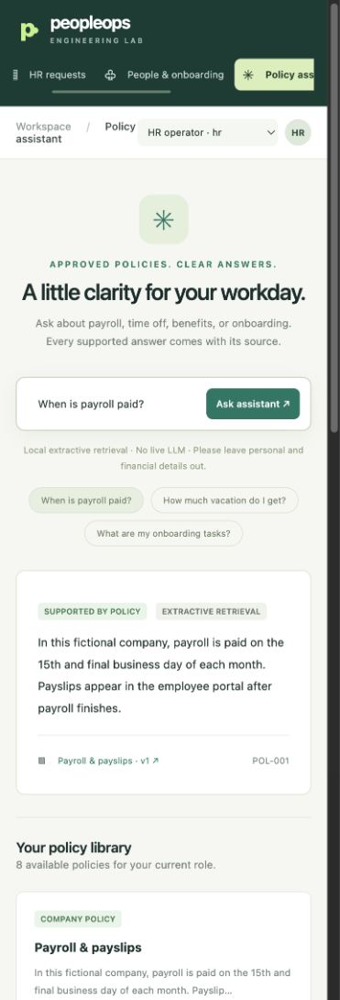

# Implementation progress and evidence

Evidence date: October 17, 2026 (Asia/Seoul). This records implementation checks,
not an independent acceptance review or a learner mastery assessment.

## Completed implementation

- [x] Phase 1: Fictional payroll request scenario and explicit business outcomes.
- [x] Phase 2: Isolated Python environment, locked dependencies, executable launcher.
- [x] Phase 3: Twenty fictional employee records plus two duplicate source deliveries; six requests and eight policies.
- [x] Phase 4: Employee, request, onboarding, policy, audit, lineage, identity, and outbox tables with keys and constraints.
- [x] Phase 5: Operational metrics and runnable SQL for filters, grouping, HAVING, joins, CTEs, windows, and UPSERT.
- [x] Phase 6: Mock HTTP source, validation, normalization, quarantine, versioned incremental loading.
- [x] Phase 7: Six dbt models, YAML quality rules, and singular SQL tests in a separate analytics database.
- [x] Phase 8: Authenticated FastAPI endpoints and browser workspace.
- [x] Phase 9: Permission-filtered TF-IDF retrieval, exact citations, escalation, and ten evaluation cases.
- [x] Phase 10: Transactional onboarding, deduplicated mock Slack, retries, and overdue request reminders.
- [x] Phase 11: Server-side roles and ownership checks, action audit, runtime observations, and regression tests.
- [x] Phase 12: Failure simulations, growth fixture, operations runbook, learning path, and interview rehearsal.
- [ ] Learner understanding assessed for these completed components.

## Reproducible checks

Commands run from `/Users/key/_AI-OS/projects/peopleops-ai`:

| Command | Observed outcome |
| --- | --- |
| `uv run pytest` | 60 passed in 1.34 seconds, including quarantine of malformed identifier types |
| `uv run peopleops quality` | All eight SQL/freshness checks passed |
| `uv run peopleops evaluate` | 10 / 10 cases passed, including restricted-policy refusal and unsupported questions |
| `uv run peopleops dbt` | 6 models and 22 data tests completed; PASS=28, WARN=0, ERROR=0 |
| `node --check peopleops/web/app.js` | Exit 0 |
| `curl --fail --silent http://127.0.0.1:8765/health` | status=ok, simulation=true |
| `sqlite3 -header -column data/peopleops.db < sql/practice.sql` | Exit 0; grouped headcounts, joins, CTEs, latest-request window, and safe temporary-table UPSERT matched expected results |
| `PEOPLEOPS_DATA_DIR=./data/verification-tick uv run peopleops tick` | Successful replay, eight passing gates, four reminders queued and four mock messages delivered |
| Registry validator | Registry validation passed: 11 systems |

The initial ingestion result was received=22, accepted=16, rejected=4,
duplicates=2. Baseline metrics were headcount=14, new_hires_30d=5,
departures_30d=1, unresolved_requests=5, total_tasks=15, completed_tasks=1.
The growth regression test loaded 5,001 source rows and 4,995 accepted
identities. Concurrent new-hire replay produced one employee, three tasks,
and one onboarding event. Injected internal failure rolled back the business
transaction and preserved a failed run record.

## Browser evidence

Checked the local in-app browser at its actual narrow viewport:

- Overview rendered the baseline metrics and responsive stacked cards.
- Payroll prompt returned an exact POL-001 passage with a source button.
- Switching to Maya removed HR operations and showed only her own requests.
- Submitted `Payroll browser check`; the UI displayed a new open request
  routed to Payroll, owned by EMP-001.
- Switched to HR and resolved that request; Overview then showed two resolved
  requests, seven total requests, and five unresolved requests.
- Employee directory, onboarding tasks, all eight operations checks, and all
  twelve learning phases rendered in the browser.
- Final workload chart used the actual 40%/20%/20%/20% category split; the
  captured browser console contained no warnings or errors.

The resolved browser-check ticket is intentionally retained as local demo
history. Expected fresh-database counts are tested in isolated temporary
databases and are documented separately from this interaction history.

## Environment and limits

Python 3.13.0; FastAPI 0.143.3; SQLite through Python's standard library;
HTTPX 0.28.1; pytest 9.1.1; dbt-core 1.10.23; dbt-sqlite 1.10.0.
The lockfile records all resolved versions.

The pytest run emitted a Starlette warning that HTTPX-based TestClient use
is deprecated in favor of its newer test transport. Tests still passed.
dbt-core 1.10 reports its own version deprecation; the SQLite adapter's
documented compatibility currently requires the paired 1.10 line. These
warnings are preserved rather than suppressed.

The temporary preview server was stopped after browser checks; application
shutdown completed and the process exited 0. Uvicorn 0.54.0 also emitted a
Python executor-shutdown coroutine warning on interrupt in this environment.
The launcher/README commands start a new local session when needed.

No live enterprise integration, LLM generation, neural embeddings, recurring
scheduler, production deployment, production performance guarantee, or
external security certification was exercised. Role switching is deliberately
available to anyone who can reach the loopback demo in demo mode. All data is
fictional and all outbound enterprise integration behavior is mocked.
