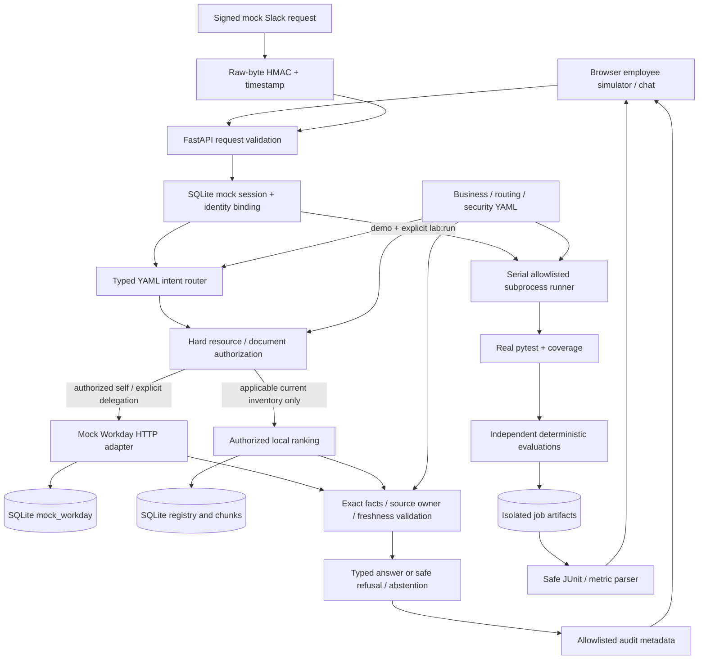

# Interactive testing layer architecture

The existing enterprise architecture and source boundaries are detailed in
`enterprise-architecture.md`. This additive layer uses the same local FastAPI
application, SQLite file and deterministic business functions.



The request, source and rule inspectors are built from actual server return
values, not inferred from the question in JavaScript. Stage clocks wrap executed
Python work. Missing stages are labeled skipped with no invented duration.
Transport/session failures stop before the source path. Fault injection creates
a per-request mock client and preserves ordinary identity and authorization.

The test process has no client-selected command, shell, path or environment.
It uses a fixed interpreter/module and named suite, separate SQLite/report paths,
bounded runtime and a minimal environment without provider keys. Only safe parsed
counts, function IDs and aggregate metrics cross back to the browser. The normal
chat remains a separate request path while a test job runs.

```mermaid
sequenceDiagram
    participant Admin as Mock lab operator
    participant API as FastAPI
    participant Runner as Serial runner
    participant Child as Python worker
    participant Files as Job artifacts
    Admin->>API: POST /admin/test-runs, named suite + session
    API->>API: Resolve SQLite identity, require demo and lab:run
    API->>Runner: Start fixed allowlisted job
    API-->>Admin: 202, opaque job ID, queued status
    Runner->>Child: Fixed argv, isolated database/reports, deadline
    Child->>Child: Execute pytest; evaluate only after complete passing suite
    Child->>Files: Actual JUnit, coverage, manifest and optional metrics
    loop while running
        Admin->>API: GET authorized job ID
        API->>Files: Read safe parsed state
        API-->>Admin: Actual status/counts, current-source flag
    end
```

A cached business response has an independent current-request trace. Its hash
binds the request to the current principal grants, business date/rules and active
governed inventory. Changed grants or inventory produce a safe 409 requiring a
new event, preventing an old receipt from restoring access. The factual result
and original correlation ID remain stable on a valid replay; timings and replay
diagnostics intentionally reflect the current request.

Trust boundaries remain the server-owned identity/rules, resource and document
ACLs, untrusted source content, validated facts, and privileged test execution.
The router and optional local judge have no authority to alter any boundary.
