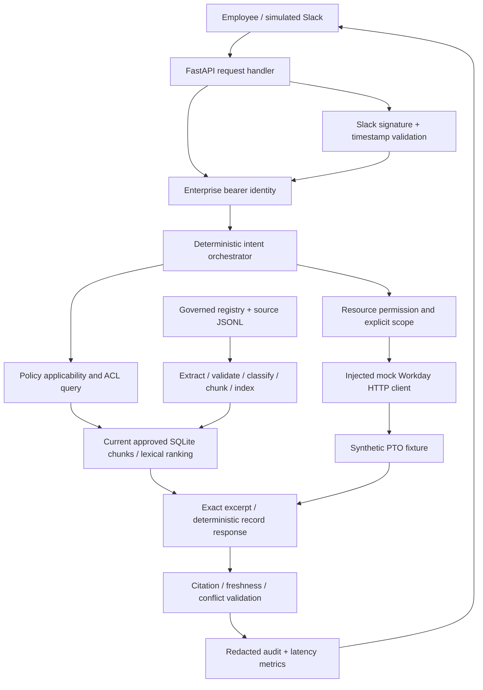

# Enterprise mock architecture



The **request handler** accepts bounded typed JSON and returns one structured
response. Invalid JSON or authentication fails before data access. The **Slack
validator** checks HMAC over raw bytes and a five-minute timestamp window;
it does not grant employee authority. **Identity resolution** maps a bearer
session and Slack workspace/user to a server-owned principal; mismatches deny.

The **orchestrator** selects a fixed workflow from a typed intent. It cannot
execute arbitrary tools. **Document permissions** check tenant, country, roles,
groups, classification, approval and dates before any text is ranked. A current
restriction or revocation never revives an old version. **Resource permissions**
check the exact employee and explicit grant before Workday's protected method.

The **Workday adapter** makes HTTP calls through an injected mock transport,
checks typed numeric records and freshness, and retries only safe reads with
bounded backoff. Unavailable, missing, stale or invalid records produce safe
statuses. **Response construction** copies evidence exactly or formats the exact
record value/unit/as-of date. Missing or contradictory evidence abstains.

The **audit sink** accepts only an allowlisted event shape: correlation ID,
intent, workflow, decision, source status, attempts, counts and timings. No raw
question, credential, employee ID or retrieved passage is logged. Aggregate
metrics are admin-only. Duplicate Slack events return a principal-bound receipt
without rerunning the protected operation; a changed payload under the same
event ID is rejected.

The **ingestion pipeline** compares documents with an independent registry before
indexing and keeps rejects with non-sensitive reason codes. All index writes in
a run are transactional. SQLite is the demo store, not a hosted vector service.
The earlier `app.api` pgvector/n8n application is a separate preserved entrypoint;
the enterprise reference entrypoint is `app.main`.

## API contracts and trust boundaries

- `POST /ask` and `/chat`: bearer identity + `{question}` → status, answer,
  citations, source facts, requirement IDs, safe component trace, request ID.
- `POST /slack/events`: separately signed mock Slack envelope plus enterprise
  bearer session → the same response. An untrusted `user`, role or employee ID
  never overrides the authenticated principal.
- `POST /admin/ingest`: explicit admin permission → registry-controlled ingestion
  metrics. HTTP input cannot replace the registry or supply an arbitrary file path.
- `/admin/observability` and `/admin/audit/{request_id}`: explicit audit permission.

```mermaid
sequenceDiagram
  participant S as Mock Slack
  participant H as FastAPI
  participant A as Identity / permissions
  participant O as Orchestrator
  participant W as Mock Workday
  S->>H: Signed raw event + separate bearer session
  H->>A: Verify signature, identity and user binding
  A-->>H: Server-owned principal
  H->>O: Question + principal + correlation ID
  O->>A: Can principal read requested employee PTO?
  alt authorized
    O->>W: Bounded read of synthetic record
    W-->>O: Exact value + unit + effective date
    O-->>H: Deterministic answer + redacted trace
  else denied
    O-->>H: Generic denial; no protected read
  end
  H-->>S: JSON result; no real Slack message
```

The system assumes a trusted local administrator controls registry and fixtures.
Production identity issuance, secret rotation, distributed queues, least-privilege
storage, encryption, retention and owner-approved policy governance remain explicit
production controls, not claims about this demonstration.

## Component inputs, outputs and failures

| Component | Input → output | Failure boundary |
| --- | --- | --- |
| Mock portal / Slack simulator | Fictional question and session → HTTP request | Connection error/timeout shown without inventing a result |
| Request handler | Bounded JSON/headers → typed request and correlation ID | 413/422 for size/schema; no reflected private input |
| Slack validation | Raw bytes, timestamp, signature → transport proof | 401 on wrong signature or old/future replay window |
| Enterprise identity | Bearer session + signed Slack user/workspace → principal | 401 for missing session; 403 for mismatched binding |
| Intent router | Question → one of seven typed intents | Ambiguous clarifies; unsupported abstains |
| Resource permissions | Principal, target, explicit grant/purpose → allow/deny | Deny before protected method; HR role alone insufficient |
| Document permissions | Latest inventory metadata + principal/date → permitted versions | Removed/revoked/expired/wrong scope yields no evidence |
| Mock Workday | Authorized target → exact value, unit, as-of | Bounded 429/503/timeout reads; missing/stale/malformed/wrong owner cannot answer |
| Local retrieval | Authorized chunks + question → ranked evidence | Empty/weak matches abstain; no global text ranking before ACL |
| Response builder | Verified record or evidence → facts/citations/status | No numeric generation; conflicting claims abstain |
| Registry pipeline | Governed metadata/digest + sources → index and reject report | Reject invalid records; immutable conflicts roll back the run |
| Receipt store | Principal-bound event ID and digest → cached authorized response | Changed event payload gives 409; concurrent replay executes once |
| Audit and metrics | Allowlisted operational fields → JSON events and aggregates | Private fields rejected; storage outage gives generic 503 |
| Evaluation/CI | Independent labels, tests and current source → measured gates/artifacts | Failed cases, low coverage, stale evidence or missing mappings block candidate |
