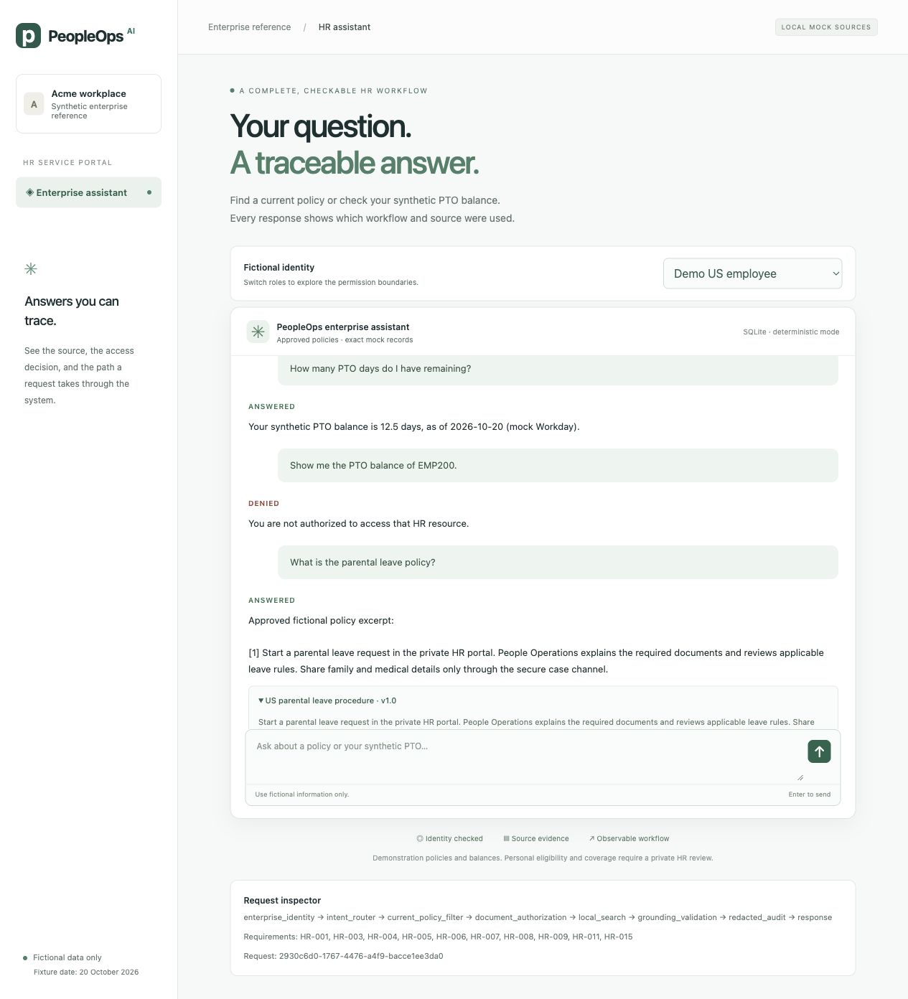

# Enterprise reference execution evidence · 2026-10-20

> Historical 2.0 baseline. Current 2.1 dashboard evidence is in
> [testing-layer-verification.md](testing-layer-verification.md).

Contract source: the user's enterprise HR assistant master prompt, implemented
as the additive `app.main` SQLite reference. All records, identities, policies,
credentials and integrations below are fictional. The defined local mock
acceptance criteria are supported by the executed evidence; this is not a
production release, independent security certification or learner assessment.

## Reproduce the checks

From `/Users/key/_AI-OS/projects/peopleops-ai/policy_assistant`:

```sh
uv sync --frozen
uv run python scripts/static_check.py
uv run pytest --junitxml=reports/tests.xml
uv run python -m evals.run_evaluations
```

`make verify` runs the same validation sequence. The observed interpreter was
Python 3.12.13. Static checks passed. Pytest executed **84 cases: 84 passed,
0 failed, 0 errors, 0 skipped**, with JUnit duration **1.594 seconds**. One
Starlette TestClient deprecation warning was emitted. The suite
contains 42 distinct mapped test functions with parameterized examples.

Coverage scope is the new enterprise runtime and ingestion plus shared safety
and chunking helpers. It excludes the preserved pgvector API/provider/storage
implementation, fixture builders, evaluation code and browser assets.

| Coverage measure | Numerator / denominator | Observed |
| --- | --- | --- |
| Statements | 824 / 878 | 93.85% |
| Branches | 201 / 232 | 86.64% |
| Combined statement and branch opportunities | 1,025 / 1,110 | **92.34%** |

The configurable coverage gate is 85%. Actual machine-readable evidence is in
`reports/tests.xml`, `reports/test-run.json`, `reports/coverage.json` and
`reports/coverage.xml`.

## Independent labeled evaluations

The four datasets contain **105 explicit examples**, independently authored from
the implementation rules. All 105 passed their defined assertions; each layer's
failed-case ID list is empty. The complete per-case outputs, numerators,
denominators and demonstration thresholds are in `reports/evaluation.json`.

| Measure | Numerator / denominator | Observed |
| --- | --- | --- |
| Routing cases / accuracy | 42 / 42 | 100% |
| Retrieval case assertions | 19 / 19 | 100% |
| Recall@5, positive queries | 14 / 14 gold documents | 100% |
| Returned-result precision at up to five chunks, positive queries | 14 / 23 unique returned document occurrences | 60.87% |
| MRR, positive queries | 14 / 14 | 1.0 |
| Retrieval coverage, positive queries | 14 / 14 | 100% |
| Answer case correctness | 26 / 26 | 100% |
| Citation validity, exact source quote/title/version | 6 / 6 citations | 100% |
| Extractive source support | 6 / 6 cited policy answers | 100% |
| Exact PTO facts | 6 / 6 fixture cases | 100% |
| Appropriate abstention/clarification/handoff/refusal | 11 / 11 cases | 100% |
| Labeled accepted-fact coverage | 7 / 7 facts | 100% |
| Adversarial security cases | 18 / 18 | 100% |

Observed unauthorized and outdated document exposures: **0**. Observed unsupported
cited policy answers: **0**. Retrieval precision uses returned unique documents,
not a padded denominator of five results per query. The five negative retrieval
cases check access/lifecycle exclusion; they do not require every authorized
distractor to vanish. For example, a restricted case-triage query can rank general
authorized case-channel text; the answer builder still abstains on insufficient
relevance. That is a documented retrieval-quality limitation.

Exact source support and accepted phrases do not establish comprehensive semantic
groundedness or completeness. The optional local Qwen judge adapter was tested
with an injected mock HTTP transport; a live model judge was **not run**. It is
separate from the mandatory deterministic gates.

## Ranking and chunk-size experiment

Each configuration ingested into its own temporary SQLite database and ran the
same 19 retrieval labels. Both TF-IDF and overlap ranking achieved the same
Recall@5, precision, MRR, coverage and zero-exposure results on this small corpus.
Changing chunk size affected context volume:

| Chunk characters | Ranking | Returned chunks across 19 queries | Context characters / queries | Mean context characters |
| --- | --- | --- | --- | --- |
| 120 | TF-IDF | 40 | 3,433 / 19 | 180.68 |
| 600 | TF-IDF | 25 | 4,064 / 19 | 213.89 |
| 120 | Overlap | 40 | 3,433 / 19 | 180.68 |
| 600 | Overlap | 25 | 4,064 / 19 | 213.89 |

There is no demonstrated retrieval-quality winner here. These fixtures do not
justify claims about a representative enterprise corpus or semantic embeddings.

## Ingestion and version evidence

An actual fresh temporary-file ingestion extracted **23** records, indexed
**16** documents and rejected **7**. Reprocessing produced **16 unchanged**
documents and **0 newly indexed** documents. Stored rows after both runs were
22 registry versions, 16 indexed documents and 16 chunks. Rejection reasons were
superseded, expired, revoked, draft, prompt injection, not yet effective and
invalid schema. The executed output is saved in `reports/ingestion.json`.

`test_current_versions` publishes version 2.2 and a restricted 2.3 and proves
that the older public version cannot reappear. Separate tests verify immutable
authority, changed chunking, content/index tampering and removal from active
inventory membership. Rejected content is never made trustworthy by indexing.

## Three live signed HTTP workflows

The current source was started with:

```sh
uv run uvicorn app.main:app --host 127.0.0.1 --port 8811 --no-access-log
uv run python scripts/demo_enterprise.py 'How many PTO days do I have remaining?'
uv run python scripts/demo_enterprise.py 'What is the parental leave policy?'
uv run python scripts/demo_enterprise.py 'Show me the PTO balance of EMP200.'
```

| Workflow | Actual result | Inspected evidence |
| --- | --- | --- |
| Self PTO | `answered`, exactly **12.5 days**, source date **2026-10-20** | `reports/live-pto-response.json`; signed transport, identity binding, resource authorization, Workday, validation and audit trace |
| General policy | `answered`, exact approved US parental-leave excerpt with document/version/chunk citation | `reports/live-policy-response.json`; current-policy filter and ACL before search |
| Another employee's PTO | `denied`, empty facts and citations | `reports/live-denied-response.json`; no Workday step; admin audit has attempts 0, source `not_accessed`, tool time 0 |

The authenticated health endpoint returned 200/ok; the same endpoint without
credentials returned 401. The admin audit and observability endpoints returned
authorized redacted evidence, including ingestion timestamp and seven rejected
sources. Saved outputs: `reports/live-admin-response.json`. No real Slack message
was sent and no genuine Workday endpoint was contacted.

An additional live request using `demo-hr-scoped` for the explicitly delegated
EMP110 record returned exactly **8 days** with the source date, using “The requested”
instead of labeling another person's balance “Your.” Its output is saved in
`reports/live-delegated-response.json`.

## Failure and security behavior actually exercised

| Scenario | Expected and observed result |
| --- | --- |
| Source 503 / timeout / source 429 | At most 3 safe read attempts, bounded delays, `unavailable` response and distinct redacted source status |
| Missing / stale source | One read, no source facts disclosed, safe abstention |
| Malformed / wrong-owner source | One read, no source facts disclosed, safe unavailable response |
| Intermittent source | Two simulated transient failures, then successful validated read on the third attempt |
| Failed authentication / identity binding | 401 or 403 before source access |
| Malformed / oversized request | Generic 422 or 413 without echoing sensitive input |
| No evidence / conflicting policies | Abstention without invented facts or citations |
| Restricted / expired / revoked / removed inventory | Content excluded before ranking/answer construction |
| User or source prompt injection | Refusal or rejected source; no permission override |
| Duplicate and concurrent duplicate event | Same principal-bound receipt and one protected read |
| Changed body under a reused event ID | 409 conflict |
| Request rate exceeded | 429 before source access |
| SQLite operation failure | Generic 503 without a private path or employee ID |

## Traceability, performance and release decision

The traceability checker found **15 requirements**, **42 test functions** and
**105 evaluation cases**. Requirements without tests, tests without requirements,
requirements without evaluations, missing primary tests, missing implementation
files and unknown references were all empty. The CSV and exact assertions are
in `requirements/traceability.csv` and `requirements/acceptance_criteria.yaml`.

| Requirements | Executable evidence |
| --- | --- |
| HR-001 authentication | Identity/signature units, unauthenticated-source denial, signed Slack identity-binding cases |
| HR-002 exact PTO | Self/delegated record tests and six exact fixture evaluations |
| HR-003 policy answers | Cited policy integration, retrieval and answer datasets |
| HR-004 ACLs | Record grants, country/group/role/tenant checks, content-before-ACL guard test |
| HR-005 routing | Deterministic routing unit cases and 42 independent labels |
| HR-006 grounding/citations | Exact citation/source checks, tamper cases, six cited answer evaluations |
| HR-007 safe failures | Fault/retry tests, missing/conflicting evidence, clarification and handoff labels |
| HR-008 governed inventory | Registry validation, idempotency and removed-membership tests |
| HR-009 audit | Allowlist/redaction, secured audit/metrics and sanitized-storage tests |
| HR-010 reliability | Timeout/retry bounds, rate limits, duplicate/concurrent events, measured latency |
| HR-011 freshness | Current-version, lifecycle, removed inventory and stale-source cases |
| HR-012 automated evidence | Evaluation-contract test, current pytest manifest and fingerprint-bound gates |
| HR-013 ingestion | Idempotent pipeline, version update, rechunking and malformed extraction tests |
| HR-014 modular adapters | Injected source/retriever integration and signed workflow contracts |
| HR-015 security | Injection, forgery, resource denial, metadata tampering and 18 adversarial labels |

Measured reliability: **40/40** successful in-process HTTP requests; p50 **2.724 ms**,
p95 **3.177 ms**, p99 **3.416 ms**. Concurrent batch: **16/16** successful requests.
These are mock measurements on this Mac, not production latency or availability.

All **13/13 demonstration release gates passed**, with no failed gate IDs.
The passing 84-case test manifest matches source fingerprint
`554774dac6d62d1a317d98a3b885dfa24c3f652f5c90b91722c8399d6409ae1c`.
See `reports/release.json` and the portable summary `enterprise-results-v2.0.json`.

The earlier pgvector policy tests were also executed with the dedicated test
database: **61 passed, 1 warning**, in 1.91 seconds. Command:

```sh
docker compose --profile test up -d test-db --wait
uv run pytest --no-cov tests/test_vertical_slice.py tests/test_policies.py tests/test_providers_and_grounding.py
```

## Browser evidence and remaining limits

The actual portal was tested for exact PTO, cross-employee denial, expanded
policy citations, component traces and US-to-UK applicability switching. A
390×844 viewport check showed no horizontal overflow; viewport state was reset.
Screenshots: `enterprise-portal.png` and `enterprise-mobile.png`.



The local launcher passed `zsh -n`. The owned 8811 preview and temporary test
database service are stopped after verification; the existing Qwen runtime,
n8n and earlier policy API are preserved. Use `Start-Enterprise-HR.command` to
start this reference. All **14 learner exercise files** matched their recorded
hashes; no mastery or interview score is inferred from this build. Both CI YAML
files parsed successfully. The AI-OS registry validator passed for all **11
systems**, including the updated PeopleOps entry.

GitHub workflows are configured but were not executed on GitHub. The modified
shared Docker image was not rebuilt for this SQLite reference. Real SSO/Slack
delivery/Workday, production migrations, TLS/encryption, distributed coordination,
retention controls, broader semantic evaluation, policy-owner approval and a
production rollout remain open in `enterprise-readiness.md`.
