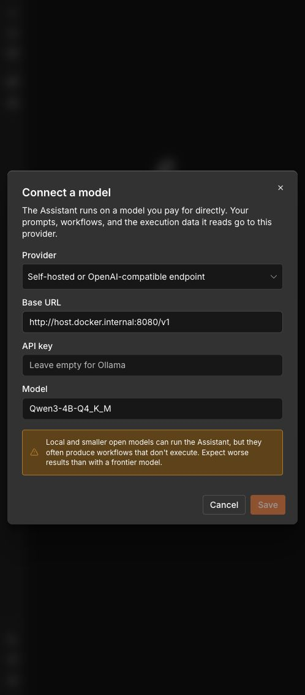

# Local Qwen on the Mac

The PeopleOps n8n workflow now delegates evidence selection to the installed
AI-OS model **Qwen3-4B-Q4_K_M**, served by the existing llama.cpp runtime.
The model file is discovered by AI-OS in `~/.local/share/ai-os/models/`.
No new model download is needed.

```text
Chat → FastAPI /chat → n8n webhook → FastAPI /ask
  → current, permitted pgvector evidence
  → local Qwen on the Mac → validated citation IDs → cited answer → chat
```

Qwen runs on Mac hardware, with its server bound to `127.0.0.1:8080`. The
application containers reach that same server through
`http://host.docker.internal:8080/v1`. This is a connection to the Mac, not a
cloud Qwen service. The app's local profile rejects nonlocal provider URLs.

## Configuration

The project `.env` selects:

```dotenv
LLM_PROVIDER=qwen_local
PROVIDER_BASE_URL=http://host.docker.internal:8080/v1
LLM_MODEL=Qwen3-4B-Q4_K_M
ALLOW_EXTERNAL_PROVIDER=false
PROVIDER_TIMEOUT_SECONDS=30
EMBEDDING_PROVIDER=mock
```

`qwen_local` uses the existing OpenAI-compatible transport. It disables Qwen's
thinking mode for this small selection task and requests schema-constrained JSON.
Qwen can propose permitted source IDs; Python validates them and constructs
the final source excerpts. Personal HR escalation still runs before a model call.

The **embedding provider is still the deterministic offline mock**. The installed
Qwen is a chat model; this change does not claim it is a semantic embedding model.
No policy reindex is required because the embedding space has not changed.

The n8n HTTP node continues to call FastAPI, whose local model connection powers
the PeopleOps policy workflow. Separately, the editor's built-in Assistant model
was connected through its **Self-hosted or OpenAI-compatible endpoint** option,
using the same base URL and model alias with an empty API key. Its connection test
passed and the saved configuration survived a page reload.

The Assistant displays `openai/Qwen3-4B-Q4_K_M`; `openai/` identifies the compatible
adapter in that UI. The actual endpoint is the Mac, with no OpenAI API key.
Code sandbox and web search remain unconfigured. Connecting the model does not
prove autonomous workflow generation or code execution; those separate Assistant
setup steps were not enabled by this model connection task.



## Start and inspect

Double-click `../Start-Policy-Assistant.command`. It now checks local Qwen first,
starts AI-OS's existing `python -m py_dev serve` command if needed, and starts
the app's Compose services. A healthy server with the configured model is reused.
It will not replace another loaded model.

Manual commands, from `policy_assistant/`:

```sh
uv run python scripts/start_local_qwen.py
docker compose up --build -d --wait
uv run python scripts/example_requests.py "How do I request PTO?" --via chat
```

The runtime log for servers started by the helper is `reports/qwen-server.log`.
It is ignored by Git. The helper starts a separate process, so the model stays
available when its launcher exits. It does not install a boot/login service.
Stopping Docker does not stop the separately running Mac model server.

For the shared runtime's metadata check, run `python3 -m py_dev check` from the
AI-OS root. From the Mac, `http://127.0.0.1:8080/health` checks runtime readiness
and `/v1/models` lists the loaded alias. `/admin/health` checks app/database
readiness and reports `qwen_local`; it requires the existing admin token.

## Revert

Set `LLM_PROVIDER=mock` and recreate the API container with
`docker compose up -d --force-recreate api`. No document or learner state needs
to be removed. The original OpenAI-compatible external profile remains available
only through its separate explicit opt-in.

The local API options follow the
[llama.cpp server documentation](https://github.com/ggml-org/llama.cpp/blob/master/tools/server/README.md).
See `verification.md` for actual live-model results, including any abstentions.
