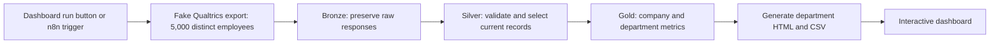
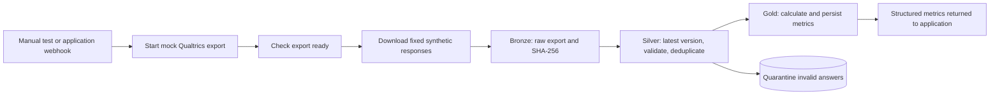

# Qualtrics test → Bronze → Silver → Gold

## 5,000-employee department analytics

### Final results report

Open the [final employee experience report](http://127.0.0.1:8812/report).
The guide and dashboard both have a **View final report** button. The report has
an executive summary, a department comparison chart, a complete scorecard,
question coverage, calculation rules and Gold provenance. All results are fictional.
Use **Download report** for a self-contained HTML file or **Print / Save PDF**
for the browser's print dialog. Department CSV is also available.

`render_final_report()` reads one published Gold snapshot and lays out its
aggregates for a manager. It derives comparison statements from that snapshot
and does not generate new survey scores or explanations of causes.
See [final report verification](docs/final-report-verification.md) for the
29-test run, live n8n checks and browser evidence.

### Hiring manager review pack

Open [the guided architecture and reviewer pack](http://127.0.0.1:8812/guide)
from the dashboard header. It includes six guided stages, an Execute button for
the actual published n8n webhook, BRD summaries, expandable acceptance criteria,
and a five-minute interview demonstration script. The guide clearly separates
the earlier 500-request small-fixture test from 5,000 distinct fictional people.

Share the editable [BRD](docs/manager-pack/BusinessRequirements.docx) and
[requirements document](docs/manager-pack/WorkflowRequirements.docx) with remote
reviewers. Each is three pages and was rendered with the bundled document runtime
and visually inspected. The [vector architecture diagram](docs/manager-pack/architecture.svg)
and [traceability CSV](docs/manager-pack/requirements.csv) can also be shared.
The localhost execution links work on the demo Mac, not a remote reviewer's computer.

Pack content is maintained in `manager_pack_content.py`; the authoring utility
`build_manager_pack.py` generates the Word documents, diagram and standalone HTML.
It requires `python-docx` and Pillow from the Codex document runtime and is not
imported by the app or n8n containers. The existing app dependencies are unchanged.
Actual current execution and document checks are in
[manager pack verification](docs/manager-pack-verification.md).

The main product dashboard is now at
[localhost:8812/dashboard](http://127.0.0.1:8812/dashboard), driven by
[the 5,000-person n8n workflow](http://127.0.0.1:5680/workflow/samsaraSurvey5000).
Click **Run n8n pipeline** to collect the source, commit Bronze/Silver/Gold, and
generate the interactive visualization plus HTML and CSV downloads. Run history
is retained in n8n. An identical rerun adds no duplicate survey rows.

This uses **5,000 distinct fictional employees**, not 5,000 downloads of the
small fixture. The organization name is illustrative: there is no claim about
actual Samsara staffing, department sizes or survey results. “Consumer scoring”
is implemented as employee survey sentiment, not employee performance ranking.
The seeded cohort has one completed response per employee; individual questions
can be skipped, and those answers are excluded from the relevant denominator.

| Illustrative department | Fictional employees |
|---|---:|
| Engineering | 1,200 |
| Sales | 1,000 |
| Customer Success | 700 |
| Operations | 600 |
| Support | 450 |
| Product | 300 |
| Marketing | 250 |
| Finance | 200 |
| People | 180 |
| IT | 120 |
| **Total** | **5,000** |

The dashboard supports department filtering, experience/CSAT/eNPS comparison,
signed eNPS bars, per-question answered counts, provenance and batch fingerprint,
and all-department HTML/CSV exports. Downloads always cover the entire cohort;
the department filter only changes the dashboard view. There is one October
snapshot, so no invented time trend or historical comparison is shown.

Actual generated company results: **75.99/100 experience**, **68.56% CSAT**,
and **+5.60 eNPS**. Experience = mean engagement (1–5) × 20, with attainable
range 20–100; it is not CSAT or a weighted blend of the other metrics. Its
answered denominator is **4,865**; CSAT has **4,828** answers and eNPS **4,879**.
Overall scores are calculated from individual answered values, not an unweighted
average of department averages. Department scores retain their own sample sizes.

The 15-row demo, its 500-request historical load report, and its original n8n
workflow remain available independently. The cohort selects
`{"dataset":"employees5000"}` when starting the authenticated mock export.
Its separate survey ID is `SV_SYNTHETIC_SAMSARA_5000`, and its Gold metric version
is `survey-metrics-v2`. Full export JSON is collected in one request; pagination,
incremental sync and real Qualtrics integrations are not implemented.



Start with `sh start.sh` in this directory. The existing `peopleops-policy:local`
Docker image and n8n stack are prerequisites; no new paid service or dependency
was introduced. The added workflow is `samsaraSurvey5000`; the existing three
demo/error workflows are preserved. All services remain published to loopback.

```sh
curl -X POST http://127.0.0.1:5680/webhook/samsara-survey-5000 \
  -H 'Content-Type: application/json' -d '{}'
curl http://127.0.0.1:8812/analytics

cd /Users/key/_AI-OS/projects/peopleops-ai
policy_assistant/.venv/bin/python -m pytest survey_analytics/tests -q
policy_assistant/.venv/bin/python -m survey_analytics.cohort_smoke
```

`/analytics/run` calls only the fixed local n8n webhook and accepts no user-supplied
URL or command. `/analytics/publish` requires a valid batch ID that already has a
complete cohort Gold snapshot. HTML/CSV downloads contain aggregates, not employee
or response IDs. Portable HTML includes its report content and styles, so the
report can be read offline; links back to the app require the running service.

Generated files are also saved to `data/visualizations/<batch>.html` and `.csv`.
Convenient copies from the live HTTP verification are in
[reports/samsara-5000.html](reports/samsara-5000.html) and
[reports/samsara-5000.csv](reports/samsara-5000.csv). Read
[reports/cohort-smoke.json](reports/cohort-smoke.json) for actual execution evidence.

Core additions in elementary language:

- `cohort_fixture()` creates independent copies of the same seeded fictional population.
- `build_cohort()` wires the full collection-to-visualization sequence into n8n.
- `get_cohort_gold()` reads an already committed cohort aggregate snapshot.
- `render_dashboard()` embeds those aggregates into an interactive HTML page.
- `publish_visualization()` atomically saves the complete HTML report and department CSV.
- `cohort_smoke.main()` runs the real workflow, checks all 5,000 people and department scores, and downloads its reports.

## Preserved small-fixture reference

This is an additive, **synthetic-only** survey analytics lab for the local
Samsara-style PeopleOps learning application. It is not a Samsara integration
and has no connection to a Qualtrics account. The HR policy app, Qwen provider,
employee fixtures, and learner exercises are unchanged.

Open the running orchestrator:
[n8n workflow](http://127.0.0.1:5680/workflow/qualtricsGold01).
Choose **Run synthetic survey** from the trigger selector, then **Execute**.
Double-click any executed HTTP node and inspect **Output → JSON**.
Published webhook runs are also available in the **Executions** tab. This
synthetic workflow saves its node outputs; the HR chat workflow still does not.



The local mock completes immediately. It demonstrates the export lifecycle,
but does not implement actual Qualtrics authentication, ZIP/CSV parsing,
pagination, delayed export polling, incremental watermarks, or rate limits.
A real adapter would start an export, poll its progress with bounded backoff,
download the completed file, and map actual survey question IDs to this schema.
See [Qualtrics' export lifecycle documentation](https://www.qualtrics.com/support/integrations/api-integration/common-api-questions-by-product/).
Actual account data is deliberately rejected by this lab's Bronze endpoint.

## Layers and fixture

The fixed closed cohort has 20 synthetic invitations. Its export contains 15
deliveries: 12 valid unique response IDs, one duplicate delivery, an older
revision, and an invalid 1–5 score of 9. Bronze stores the exact export and 14
distinct raw versions. Silver keeps the latest version before validation,
accepts 12 responses (10 complete, two partial), quarantines one, and supersedes
one revision. It never revives an older valid response when the newest fails.

Tables live in `data/survey.sqlite3`: `bronze_batches`, `bronze_responses`,
`silver_responses`, `quarantine`, `stages`, and `gold_snapshots`.
The SHA-256 export key travels through all stages; Silver keeps its selected
raw content hash and Gold records its batch key and metric-definition version.
Each stage commits atomically and retries return the committed result.
This is a full snapshot of one fixed cohort, not an incremental production warehouse.

## Gold metric definitions

These are explicitly chosen demo definitions, not claims about Samsara policies.
Score metrics include only finished, valid responses; each question excludes
its missing answers independently. Unknown or zero denominators produce null.
Missing answers never become zero scores.

| Metric | Numerator / denominator or rule | Actual fixture output |
|---|---|---:|
| Response rate | Valid completed / invitations in this closed cohort | 10 / 20 = 50% |
| Completion rate | Valid completed / valid started responses | 10 / 12 = 83.33% |
| Engagement mean | Sum of answered 1–5 scores / answered count | 39 / 10 = 3.9 |
| Engagement favorable | Engagement scores 4–5 / answered count | 7 / 10 = 70% |
| CSAT top two box | Satisfaction scores 4–5 / answered count | 7 / 9 = 77.78% |
| eNPS | 100 × (9–10 promoters − 0–6 detractors) / answered count | 100 × (4 − 2) / 9 = +22.22 |
| Median completion duration | Median seconds for valid finished responses | 195 seconds |

All department slices are withheld when any department's completed or per-question
sample is below five. Withholding the entire breakdown also avoids exposing a
small group's values by subtracting visible slices from the total. This is a
conservative demo rule, not a comprehensive privacy/anonymization system.

## Start and inspect

Prerequisites: Docker Desktop and the existing `policy_assistant` stack (including
the already-built `peopleops-policy:local` image and local n8n). Start that stack
using its existing launcher if necessary. No new Python dependencies or paid keys
are required: the sidecar uses the existing Python 3.12 image and libraries.

```sh
cd /Users/key/_AI-OS/projects/peopleops-ai/survey_analytics
sh start.sh
```

The script starts the sidecar, imports/publishes the survey workflow, its local
error handler, and a deliberately failing test probe, then briefly restarts n8n
so it registers the webhooks. It does not delete volumes or
change the other workflow. Re-running the import replaces edits to this demo
workflow with the checked-in JSON. Ordinary later starts need only
`docker compose up -d --wait`; the workflow persists in n8n's existing volume.

```sh
curl -X POST http://127.0.0.1:5680/webhook/qualtrics-gold-test \
  -H 'Content-Type: application/json' -d '{}'
curl http://127.0.0.1:8812/layers
```

The webhook body is ignored: the workflow always reads the fixed server-owned
fixture. It accepts no source URLs, tokens, survey overrides, commands or employee
data. Source simulator endpoints require a public fake token; the layer operations
and n8n test webhook remain unauthenticated. HTTP publishing is bound to loopback
and the service also participates in the existing local Docker network.
Do not expose it publicly or repurpose it for actual survey data.

[Gold output viewer](http://127.0.0.1:8812/) ·
[API contracts](http://127.0.0.1:8812/docs) ·
[persisted aggregate JSON](http://127.0.0.1:8812/layers).

Stop only this added service with `docker compose stop` in this directory.
Keep `data/` to retain the layers. The original n8n and HR app remain running.

## Reproduce checks

```sh
cd /Users/key/_AI-OS/projects/peopleops-ai
policy_assistant/.venv/bin/python -m pytest survey_analytics/tests -q \
  --junitxml=survey_analytics/reports/tests.xml
policy_assistant/.venv/bin/ruff check survey_analytics
policy_assistant/.venv/bin/python -m survey_analytics.smoke
```

These tests use temporary SQLite databases. They cover exact metric arithmetic,
missing-answer denominators, schema/range checks, latest-version rejection,
concurrent retries, row-count idempotency, stage ordering, small-group withholding,
and the fixed-fixture HTTP boundary. The smoke script executes the actual published
n8n webhook twice and checks durable Gold output and unchanged row counts.

Regenerate the importable JSON after editing `build_workflow.py`:
`policy_assistant/.venv/bin/python -m survey_analytics.build_workflow` from the
project root. Import through `sh start.sh` afterwards.

## Core functions, in plain language

- `export_fixture()` creates fictional survey answers and deliberate test errors.
- `canonical()` and `digest()` encode data consistently and assign it a stable fingerprint.
- `connect()` opens the local database and ensures its tables exist.
- `cached()` reads a finished stage; `save_stage()` saves a stage's result with its changes.
- `ingest_bronze()` preserves the original export and ignores exact duplicate versions.
- `validate_response()` checks dates, types, departments, durations, and score limits.
- `transform_silver()` chooses each response's newest version and quarantines invalid answers.
- `metric()` calculates a value together with the numerator and denominator that produced it.
- `score_metrics()` calculates survey scores from complete responses with answered questions.
- `publish_gold()` writes one versioned aggregate snapshot and withholds unsafe department slices.
- `inspect_layers()` returns table counts and Gold snapshots without individual answers.
- `create_app()` exposes the fixed source and layer operations through local HTTP endpoints.
- `http_node()` and `build()` generate the n8n nodes, retries, connections and explanatory notes.
- `smoke.main()` runs the real webhook twice and checks its persisted results.

## Fake local account and 500-request load test

The local account ID is `acct_local_synthetic_001`. All `/mock-qualtrics/*`
endpoints require this header:

```text
X-API-TOKEN: FAKE-QUALTRICS-LOCAL-ONLY-NOT-A-REAL-TOKEN
```

This is a public, deliberately fake fixture value, not a secret or a credential
for an actual Qualtrics account. It cannot authenticate with Qualtrics. Do not
put a real token into this simulator. The n8n source nodes already send this fake
header on start, status and download requests. Its normal Gold flow still works.

```sh
curl http://127.0.0.1:8812/mock-qualtrics/account \
  -H 'X-API-TOKEN: FAKE-QUALTRICS-LOCAL-ONLY-NOT-A-REAL-TOKEN'

curl -X POST http://127.0.0.1:8812/mock-qualtrics/exports \
  -H 'X-API-TOKEN: FAKE-QUALTRICS-LOCAL-ONLY-NOT-A-REAL-TOKEN'
```

Use the returned export ID with `GET /mock-qualtrics/exports/{export_id}` and
`GET /mock-qualtrics/exports/{export_id}/file`, sending the same header. Requests
without the token or with an incorrect token receive HTTP 401.

Run the actual load test from the project root:

```sh
cd /Users/key/_AI-OS/projects/peopleops-ai
policy_assistant/.venv/bin/python -m survey_analytics.load_test \
  --requests 500 --concurrency 20
```

The target is fixed to `http://127.0.0.1:8812`; external hosts, proxies and
redirects are not used. Limits are 10,000 total requests and 50 in flight;
the default is 500 at concurrency 20. Requests have a 10-second timeout and no
automatic retries. Each downloaded payload must match the known export SHA-256.
Five account/authentication/export setup controls precede the 500 load requests
and are excluded from throughput and latency metrics.

Actual executed result on 2026-10-20: **500/500 HTTP 200**, **500 payloads
validated**, **zero failures**, **1.554 seconds**, **321.75 requests/second**;
latency p50 **47.719 ms**, p95 **145.036 ms**, p99 **210.045 ms**.
Missing/wrong token controls returned 401; the fake token returned 200.

Each response contains the same 15 synthetic deliveries, so 7,500 row deliveries
were checked. This is repeated downloading of one fixed export, **not 500 new
survey respondents**. The export has 13 unique response IDs including its invalid
test row. These 500 GETs do not write Bronze/Silver/Gold or pass through n8n;
the separate normal n8n smoke proves the authenticated source-to-Gold flow.
This short local run is not a sustained-load, real Qualtrics, or production
capacity benchmark. Simulated throttling and delayed exports are not implemented.

See [actual load report](reports/load-test.json) and
[actual returned mock sample](reports/mock-export-sample.json).
`require_mock_token()` checks the fake source header before returning data;
`account_fixture()` describes the synthetic account. `run_load()` sends bounded
concurrent HTTP requests and validates each result; `percentile()` calculates
latency percentiles with linear interpolation; `load_test.main()` saves the report.

## n8n production checklist

All three checklist settings are configured for this local synthetic lab:

| Item | Configuration | Evidence |
|---|---|---|
| Error notifications | `qualtricsGoldError01`: Error Trigger → local HTTP inbox | Intentional failed execution 71 produced a notification |
| Track time saved | Fixed **10 minutes per production execution** | Exported `timeSavedMode=fixed`, `timeSavedPerExecution=10` |
| Enable MCP access | Instance server enabled; synthetic demo and 5,000-person workflows available | Both workflow exports use `availableInMCP=true`; authentication still required |

The 10-minute estimate is a provisional learning assumption: three minutes to
export, three to validate and deduplicate, and four to calculate/check metrics.
It is **not measured labor savings**, workflow duration, or a Samsara benchmark.
Calibrate it against a timed manual run before using it for ROI reporting.

Read the [local notification inbox](http://127.0.0.1:8812/notifications).
It stores only fixed workflow ID, execution ID, an allowlisted failed-node name,
and receipt time. It accepts no survey answers, error stacks, messages or tokens.
Duplicate error deliveries do not create duplicate inbox entries. This channel
does not send email, Slack or desktop push alerts; open the inbox to inspect it.

The intentionally failing probe at `POST /webhook/qualtrics-gold-failure-test`
is for validating the error path and is not available in MCP. Execute its check:

```sh
cd /Users/key/_AI-OS/projects/peopleops-ai
policy_assistant/.venv/bin/python -m survey_analytics.checklist_smoke
```

MCP connection URL: `http://127.0.0.1:5680/mcp-server/http`. The server still
requires authentication; **no MCP client has been connected or granted access**
by this setup. Use n8n's Settings → Instance-level MCP → Connect for a deliberate
client connection later. The HR policy workflow, error handler and failure probe
are not MCP-enabled. This configuration does not make the demonstration a
production deployment. See [n8n's MCP documentation](https://docs.n8n.io/connect/connect-to-n8n-mcp-server/).

`record_failure()` saves one local notification per execution;
`list_notifications()` reads recent notifications without source answers.
`build_error_handler()` generates the error routing workflow;
`build_failure_probe()` generates a controlled failure to test it.
`checklist_smoke.main()` proves the actual n8n error trigger reaches the inbox.

Actual evidence and limits are recorded in [docs/verification.md](docs/verification.md).
