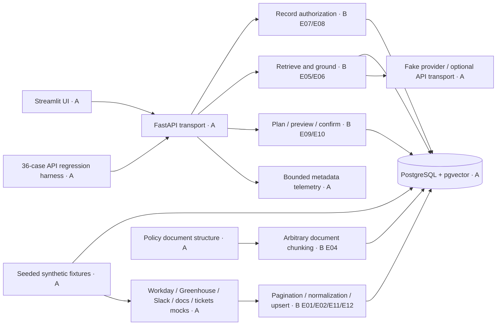

# Architecture and decisions

Solid infrastructure is Category A. Boxes marked **B** call learner-owned
functions that initially raise `PendingExercise`. Phase completion must not be
inferred from the existence of a box or a passing health check.

## Boundaries

`lab/` contains setup, typed contracts, models, deterministic providers, mock
sources, observations, and evaluation plumbing. `exercises/` contains business
decisions. API adapters call those functions directly; they do not fall back to
solved legacy code. `tests/foundation` proves infrastructure behavior;
`tests/exercises` defines the behavior to implement.

The fixture bootstrap inserts already-normalized canonical truth and pre-authored
section chunks. It is not a source normalization or document parser solution.
E01/E04/E12 must work on arbitrary inputs, not copy fixture outputs.

## Decisions and alternatives

| Decision | Why it fits this lab | Rejected alternative |
| --- | --- | --- |
| Separate `training/` environment | Preserves the old app while honoring the new stack and exercise ownership | In-place replacement risks old data and exposes completed solutions |
| One modular Python backend | Makes the full request path easy to inspect and explain | Microservices add deployment and distributed failure overhead before fundamentals |
| Synchronous SQLAlchemy sessions | Short local operations, explicit transaction scope | Async ORM adds concurrency concepts before they are useful here |
| PostgreSQL and pgvector in one database | Real joins, constraints, transactions, and vector operators in one inspectable system | Separate vector service duplicates access rules and operational state |
| Exact vector scan at fixture scale | 31 chunks do not justify approximate-index tuning | HNSW trades recall and filtering behavior for speed that this dataset does not need |
| 64-dimensional stable hash embeddings | Reproducible offline mechanics with no model download or keys | Neural embeddings would obscure plumbing and introduce model/version dependencies |
| Fake draft provider, optional Responses transport | Separates transport from correctness and lets tests run offline | A paid model as default makes each debugging step nondeterministic and billable |
| Section keys include document/version/section | Exact provenance survives chunking and citations | Document title alone cannot distinguish outdated policies |
| Public local identity simulator | Tests authenticated request plumbing without an external identity account | SSO setup is a separate production extension; it would distract from record authorization |
| Explicit proposal + confirmation + receipt models | Supports immutable approval context and transaction-backed local replay safety | Direct model-triggered writes have no human decision boundary |
| Bounded process-local telemetry | Easy to inspect and excludes payloads | Full tracing infrastructure is a Category C extension; durable audit rows remain in the schema |
| Seed marker and one transaction | Repeat startup preserves learner changes; advisory lock prevents concurrent seeding | Unconditional truncate/reseed would erase attempts and operational evidence |
| Strict evaluation coverage | Unimplemented routes cannot inflate safety or quality scores | Counting all refusals/501 responses as success gives false confidence |

Hash vectors can collide and are weak at paraphrases. Similarity is not confidence.
The fake provider echoes a supplied passage and does not decide whether it supports
the question. Authorization, relevance, refusals, citations, and malicious input
handling remain explicit exercises; no prompt text can substitute for these checks.

## API and storage lifecycle

Compose starts the healthy database, then the one-shot seed, mocks, backend,
and UI. `/health` proves the process is alive; `/ready` requires seeded storage.
Session dependencies own commit/rollback. Exercise functions should flush when
needed, never independently commit a caller-owned transaction.

Model `create_all` creates fresh tables; it is not a schema migration system.
The first schema is isolated and additive. Future schema changes require an
explicit migration and preservation tests, not deletion of the named volume.

## Primary implementation references

- [pgvector SQLAlchemy integration](https://github.com/pgvector/pgvector-python): vector columns and distance operators.
- [Compose startup conditions](https://docs.docker.com/compose/how-tos/startup-order/): health and completed seed dependencies.
- [OpenAI text generation](https://developers.openai.com/api/docs/guides/text): Responses transport and structured output content.

No live external provider result is claimed. The optional adapter is verified
against a mocked response contract only.
